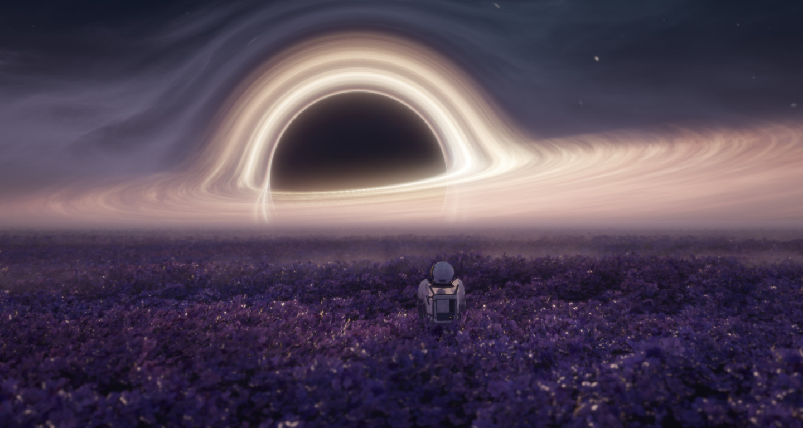

# 黑洞与紫罗兰

风穿过暮色中的紫罗兰花海。宇航员站在花间，望着一条被引力弯折的金色光带。场景在浏览器中实时渲染，花海与吸积盘都在缓慢流动。



## 运行

在 `black-hole-and-violets` 目录里打开终端，使用 Node.js 18 或更新版本运行。场景使用浏览器原生 WebGL 2，材质和人物网格随源码提供，无需安装 npm 包。

```sh
node serve.mjs
```

打开 [本地场景](http://127.0.0.1:4173/)。如端口被占用，可以运行 `node serve.mjs 4174`。也可以将 `index.html`、`style.css`、`src/` 和 `assets/` 一起放到静态 HTTP(S) 托管目录。

## 观看

镜头固定在旅人身后。使用滚轮、双指捏合或 `+`、`-` 调整焦距。系统开启「减少动态效果」时，环境动画会放慢，缩放会直接到达所选焦距。

画质默认随视口、触控设备和帧耗时调整。地址末尾加 `?quality=high` 可固定高画质，加 `?quality=low` 可启用较轻的渲染配置。浏览器需要支持 WebGL 2。

## 构图与实现

黑洞偏在中轴左侧，旅人站在另一侧低处。尘光顺着深蓝色天空稀释开，盘光落在略有起伏的花海上。中景的花脊时明时暗，两道缓慢漂移的低雾穿过远坡。焦点落在旅人上身，近处花簇保留瓣形，最远处的轮廓逐渐融进暮色。

- `src/geodesics.js` 在启动时积分无自旋黑洞的零测地线。天空着色器沿多条光路采样吸积盘，让热内缘、较暗的盘面间隙和铜色外流各自形成透镜弧。盘上的亮纹随半径差速流动，较长光路取用稍早的盘面状态。窄光子环按像素覆盖度取样，角直径、盘面倾斜和色温经过艺术调校。[Bruneton 的实时光束追踪论文](https://ebruneton.github.io/black_hole_shader/paper.pdf) · [James 等人的电影黑洞透镜论文](https://arxiv.org/abs/1502.03808)
- `src/meadow.js` 让花丛沿缓坡成片聚散。盛开的花冠沿图集的轮廓、瓣脊和瓣沟生成，半开的紫罗兰使用五片分立的花瓣。花簇、低矮的叶丛和草穗在五个距离层中逐渐变简。少量暖光穿过面向吸积盘的瓣缘，花层单独做轻微的镜头扩散。
- `src/traveler.js` 把加压服与压力盔、颈部锁环和维生背包装配在一起。较短的颈封和贴背的维生包显出肩线，肘部靠近肩部下方。宇航员两手垂在身侧，抬眼凝望金弧。呼吸和小幅换重心带动肩背，画面和两张人物阴影图使用同一套关节姿态。
- `src/shaders.js` 从实时天空全景分别取样内盘、右侧地平线、上方暮色与下方花海。盘光擦过盔顶，右侧天光沿着朝向它的纱线形成短高光。两张人物阴影图记录这两片光源各自受到的遮挡，花丛中的影子随投射距离变软。渲染器每秒最多十二次从上方拍下旅人周围约 7.6 米见方的花冠，按衣料表面朝向汇总花瓣反射的颜色，用于背部和头盔暗处的一次间接光近似。
- `src/renderer.js` 把镜头对焦在旅人的上身。前景单独累计每片失焦花瓣覆盖到相邻像素的颜色与面积，随后与对焦层和远景合成。在 900 行的初始横屏画面中，前景弥散半径平滑趋近 5 像素，远处地面的弥散半径最多为 2.75 像素。景深之后的镜头扩散在场景线性光下保留亮点中心，将余光散到邻近像素，最后叠加泛光、调色和颗粒。场景支持半浮点 HDR 缓冲，也可以回退到八位缓冲。[前景遮挡与实时景深，GPU Gems 3 第 28 章](https://developer.nvidia.com/gpugems/gpugems3/part-iv-image-effects/chapter-28-practical-post-process-depth-field) · [Tiffen 镜头扩散滤镜指南](https://tiffen.com/pages/diffusion-guide)

场景在浏览器内生成花海、头盔、装备和程序化纹理。加压服网格及材质从本地资源加载。

## 加压服资源

加压服的躯干、袖口、手套与靴子来自 NASA/LaRC/Advanced Concepts Lab 公开的 Z2 原型模型。项目调整了手臂的静置角度，移除原型的高背舱、头盔和标识，并重新制作压力盔、锁环和背包。模型经过转换，材质在场景内重新调色和照明。[NASA Z2 Spacesuit](https://science.nasa.gov/3d-resources/z2-spacesuit/) · [NASA 资源使用说明](https://www.nasa.gov/nasa-brand-center/images-and-media/)

`assets/eva-body.bin`、`assets/eva-fabric.webp` 和 `assets/eva-weave.webp` 已随项目提供。重新导出时，可以用 `node design/prepare-eva.mjs` 传入 NASA 原始 GLB、`draco3dgltf.js` 和 `sharp` 的路径。Draco 和 Sharp 仅用于转换。

项目代码采用仓库的 MIT 许可证。NASA Z2 资源的来源与使用说明见上文。Instrument Serif 字体附有 SIL Open Font License 文本。[MIT 许可证](../LICENSE) · [字体许可](./assets/Instrument-Serif-OFL.txt)

## 尘幕纹理

`assets/interstellar-dust.png` 由内置 ImageGen 生成，缩放为 1200 × 800 的灰度密度图后随项目保存。天空从两层取样，以密度改变光的散射与透过量。星光、黑洞与吸积盘由实时着色器绘制。

```text
Use case: photorealistic-natural. Asset type: one landscape grayscale optical-density matte for interstellar dust in a real-time 3D night sky. A super low-contrast long-exposure monochromatic photograph of very thin smoke diffusion in a dark chamber, seen through a huge grazing volume of almost invisible dust. One asymmetrical, horizontal-to-diagonal, extremely soft bank flows in from the lower left and drifts toward upper-middle before dissipating. Far, diffuse layered wisps with faint threadlike detail and smoothly smoky mottling. A much thinner split gauzy wisp on the right dissolves into dark negative space. Estate of values: mostly true black and near black, soft charcoal and dark midgray wisps concentrated on the left, a few dilute silver-gray ridges; reserve true black in irregular gaps and corners. Seamless-looking fades, immense scale and legato shapes, authentic almost imperceptible gas gradients with no framing. The texture will be sampled as density, so light values mean thick scattering material. Landscape 3:2. Fill the canvas as a material only. No visible light sources, no stars, no sun or black hole, no round or spiral shape, no horizon/ground, no hard silhouettes, no bright cloud towers, no purple coloration, no flare, no text, no graphic marks, no borders or watermarks.
```

## 花瓣材质

`assets/viola-blossoms.png` 包含四朵盛开的紫罗兰，提供花冠轮廓、花喉颜色和放射状瓣脉。`assets/viola-petals.png` 是内置 ImageGen 生成的单瓣图集，用于半开花朵的色素细节。两张纹理都随项目提供，在本地加载。

### 生成提示

```text
Use case: photorealistic-natural
Asset type: botanical albedo atlas for UV mapping onto real-time 3D violet petal meshes.
Primary request: one square technical asset sheet with exactly four individually detached, real Viola odorata petals photographed face-on, in a 2 by 2 grid. One isolated petal per equal quarter, centered on each quarter. The narrow pale attachment/root is DOWN at the six-o'clock position and the broad rounded slightly irregular rim is UP in every quarter. Each petal fills about 80% of its quarter height and 72% of its quarter width, with a clean wide gutter. Plain pure black background, even black all around. Top left slate violet, top right a deep indigo-violet, lower left a muted cool lavender, lower right dark aubergine with lilac at the tip. All four are real, natural small wild violet petals, not stylized. Subtle dark radiating branching capillary veins from the narrow throat, velvety cellular microtexture, soft long color gradients and natural tiny pigment variation. Diffuse calibrated cross-polarized studio lighting, evenly illuminated surface with no strong highlights and no cast shadows. Fine optical detail. No stems, no centers, no full flowers, no leaves, no arrangements, no text, no borders, no watermark.
```
